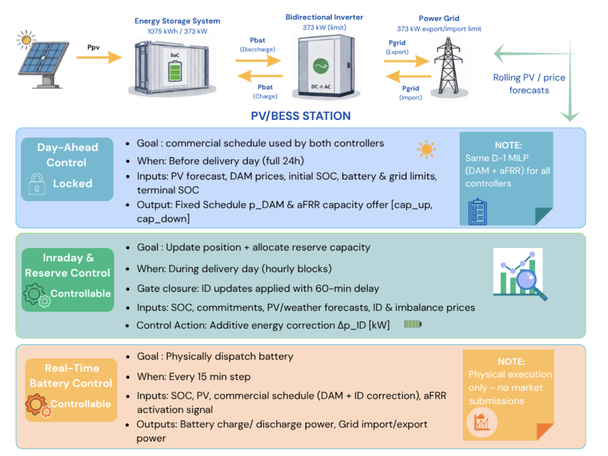

# PV-BESS-Gym

**A Gymnasium-compatible benchmark for real-time control of solar-plus-storage in the Greek electricity market.**

PV-BESS-Gym models the full three-layer decision sequence that governs a grid-connected PV+BESS plant operating in Greece: a D-1 co-optimized day-ahead and aFRR commitment, gate-closure-delayed SIDC intraday corrections, and 15-minute real-time battery dispatch. All three layers are enforced in a single Gymnasium environment with a dictionary action interface and transparent settlement accounting.

<p align="center">
  
</p>

---

## Key findings

Three controllers share the **same D-1 MILP plan** and differ only in their intraday and real-time execution layers:

| Controller | 7-day Winter [EUR] | vs. RBC | 28-day Total [EUR] | vs. RBC |
|---|---|---|---|---|
| DA-OPT-RBC | 1 572 | — | 7 836 | — |
| DA-OPT-RT-MPC | 1 928 | +22.6 % | 7 417 | −5.4 % |
| DA-OPT-MPC | 2 175 | **+38.4 %** | 9 094 | **+16.0 %** |

The SIDC intraday MPC is the dominant value driver: consistent across all seasons, it contributes EUR 1 677 of the 28-day advantage. Real-time MPC adds value in low-irradiance seasons (winter +22.7 %, autumn +4.2 %) but underperforms rule-based dispatch in spring and summer when the 8-step horizon is insufficient to plan the full daily SOC arc under abundant generation — an open research problem the benchmark is designed to support.

---

## Installation

Requires Python ≥ 3.10.

**1. Create and activate a virtual environment**

```bash
python -m venv .venv
# macOS / Linux
source .venv/bin/activate
# Windows
.venv\Scripts\activate
```

**2. Install dependencies**

```bash
pip install -r requirements.txt
```

**3. Install the package in editable mode**

```bash
pip install -e .
```

---

## Quick start

```python
from pv_bess_gym import make_unified_env

env = make_unified_env(
    signals_path="example_data",
    plant_config_path="example_data/station_athens.json",
)
obs, info = env.reset()
action = env.action_space.sample()
obs, reward, terminated, truncated, info = env.step(action)
```

Verify the interface and read the full observation/action reference:

```bash
python scripts/gym_interface.py
```

Run and compare the benchmark algorithms:

```bash
# Single algorithm, 7 days
python scripts/run_benchmarks.py --algorithm da-opt-mpc --num-days 7

# All three algorithms, with plots
python scripts/run_benchmarks.py --algorithm all --num-days 7

# Specific day indices
python scripts/run_benchmarks.py --algorithm da-opt-mpc --days 0,90,181,273
```

---

## Market structure and action interface

The Greek electricity market imposes a strict temporal hierarchy. The environment enforces each layer in sequence:

| Layer | Action key | When | Description |
|---|---|---|---|
| D-1 energy | `day_ahead` | Once, t = 0 | 96-slot DAM schedule [kW] |
| D-1 aFRR capacity | `day_ahead_afrr` | Once, t = 0 | `[cap_up_kw, cap_down_kw]` — fixed for the delivery day |
| Intraday (SIDC) | `intraday` | Every ~60 min | `[id_adjustment_kw]` — additive commercial correction |
| Real-time | `real_time` | Every 15 min | `[p_batt_kw]` — physical battery setpoint |

`obs["action_mask"]` signals which keys are due at each step:

```python
action = {
    "day_ahead":      np.zeros(96),  # when action_mask[0] == 1
    "day_ahead_afrr": np.zeros(2),   # when action_mask[0] == 1
    "intraday":       np.zeros(1),   # when action_mask[1] == 1
    "real_time":      np.zeros(1),   # every step
}
```

---

## Observation space

`obs` is a dict with four keys:

**`physical`** — shape `(24,)`, current state:

| Index | Signal |
|---|---|
| 0 | Battery SOC |
| 1 | Battery energy kWh |
| 2 | PV actual power kW |
| 3 | PV forecast power kW |
| 4–6 | GHI, temperature, wind |
| 7 | DAM price EUR/MWh |
| 8 | SIDC price EUR/MWh |
| 9 | Imbalance price EUR/MWh |
| 10–11 | aFRR up/down capacity prices EUR/MW/h |
| 12–13 | aFRR up/down activation signals [0, 1] |
| 14 | DAM commitment at current step kW |
| 15 | SIDC adjustment at current step kW |
| 16 | Scheduled position (DAM + SIDC) kW |
| 17 | Steps until next intraday block |
| 18 | aFRR block steps remaining |
| 19–20 | Time-of-day sin/cos |
| 21 | Episode progress [0, 1] |
| 22 | D-1 committed aFRR up capacity kW |
| 23 | D-1 committed aFRR down capacity kW |

**`forecast`** — shape `(horizon × 9,)`: rolling forward window of PV, weather, prices, and commercial targets.

**`day_ahead_context`** — shape `(96 × 8,)`: full delivery-day view used by the D-1 optimizer.

**`action_mask`** — shape `(3,)`: which action keys are due this step.

---

## Benchmark algorithms

| Algorithm | D-1 | Intraday (SIDC) | Real-time | Purpose |
|---|---|---|---|---|
| `da-opt-rbc` | MILP co-opt | Rule-based | Rule-based | Transparent baseline |
| `da-opt-rt-mpc` | MILP co-opt | Rule-based | MPC | Ablation: RT value only |
| `da-opt-mpc` | MILP co-opt | MPC | MPC | Full optimization |

All three use the identical D-1 MILP (jointly optimizing the DAM schedule and aFRR capacity). The benchmark isolates intraday and real-time control quality under a shared, optimal commercial commitment.

---

## Repository layout

```
pv_bess_gym/
  envs/           UnifiedPVBESSGreeceEnv — main Gymnasium environment
  agents/         benchmark agents and algorithm registry
    legacy/       legacy rolling-horizon agents (backward compatibility)
  models/         battery, grid, PV (pvlib), and settlement math
  data/           signal schema and CSV loader
  evaluation/     evaluate_agent() and output writer

scripts/
  gym_interface.py          Gym API walkthrough and agent template
  run_benchmarks.py         CLI runner for registered algorithms
  auxiliary/
    build_greek_2025_dataset.py   rebuild the dataset from raw HENEX/ADMIE files
    run_paper_experiments.py      reproduce the 4-season paper results

example_data/
  greek_2025_01.csv … greek_2025_12.csv   full-year Greek 2025 signals
  station_athens.json                      example plant configuration (550 kWp / 1075 kWh)

outputs/          simulation results (generated at runtime, git-ignored)
```

---

## Dataset

The `example_data/` folder contains monthly signal files at 15-minute resolution covering all of 2025, ready to use without any setup. Column provenance:

| Provenance | Columns |
|---|---|
| **Real** | `timestamp`, weather actuals, HEnEx DAM/SIDC prices, IPTO imbalance prices |
| **Proxy-derived** | `afrr_cap_up_eur_mw_h`, `afrr_cap_down_eur_mw_h` |
| **Synthetic** | `afrr_act_up`, `afrr_act_down` (seeded for reproducibility) |

To rebuild from raw HENEX/ADMIE files:

```bash
python scripts/auxiliary/build_greek_2025_dataset.py --year 2025 \
    --raw-henex data/raw/henex --raw-admie data/raw/admie --out data/processed
```

---

## Reproducing paper results

```bash
# Run all 12 experiments (4 seasons × 3 algorithms) — ~15–30 min
python scripts/auxiliary/run_paper_experiments.py
```

Results are written to `outputs/paper_results/`. The script prints a season × algorithm profit table matching Table IV of the companion paper.

---

## Adding a new algorithm

1. Implement your agent with `reset()` and `act(obs) → action` in `pv_bess_gym/agents/`.
2. Register it in `pv_bess_gym/agents/registry.py`.
3. Run it: `python scripts/run_benchmarks.py --algorithm your-algorithm --num-days 7`.

See `scripts/gym_interface.py` for the full agent template and observation reference.

---

## Outputs

Each benchmark run writes to `outputs/simulations/<mode>_<algorithm>/`:

```
combined_log.csv      step-level log: PV, SOC, positions, all settlement components
daily_summary.csv     one row per day: profit, final SOC, timestamps
power.png, soc.png, profit.png, revenue_stack.png
```

With `--algorithm all`, a cross-algorithm `unified_simulation_summary.csv` is also produced.

---

## Citation

If you use PV-BESS-Gym in your research, please cite:

```bibtex
@inproceedings{korkas2026pvbessgym,
  author    = {Korkas, Christos D.},
  title     = {{PV-BESS-Gym}: A Market-Sequenced {Gymnasium} Benchmark
               for Real-Time Control of Solar-plus-Storage
               in the {Greek} Electricity Market},
  booktitle = {Proceedings of the Synergy MED Conference},
  year      = {2026},
}
```

---

## License

The MIT License (MIT) Copyright (c) 2026, Power & Energy Systems Laboratory, UoWM, Greece
Permission is hereby granted, free of charge, to any person obtaining a copy of this software and associated documentation files (the "Software"), to deal in the Software without restriction, including without limitation the rights to use, copy, modify, merge, publish, distribute, sublicense, and/or sell copies of the Software, and to permit persons to whom the Software is furnished to do so, subject to the following conditions:
The above copyright notice and this permission notice shall be included in all copies or substantial portions of the Software.
THE SOFTWARE IS PROVIDED "AS IS", WITHOUT WARRANTY OF ANY KIND, EXPRESS OR IMPLIED, INCLUDING BUT NOT LIMITED TO THE WARRANTIES OF MERCHANTABILITY, FITNESS FOR A PARTICULAR PURPOSE AND NONINFRINGEMENT. IN NO EVENT SHALL THE AUTHORS OR COPYRIGHT HOLDERS BE LIABLE FOR ANY CLAIM, DAMAGES OR OTHER LIABILITY, WHETHER IN AN ACTION OF CONTRACT, TORT OR OTHERWISE, ARISING FROM, OUT OF OR IN CONNECTION WITH THE SOFTWARE OR THE USE OR OTHER DEALINGS IN THE SOFTWARE.
