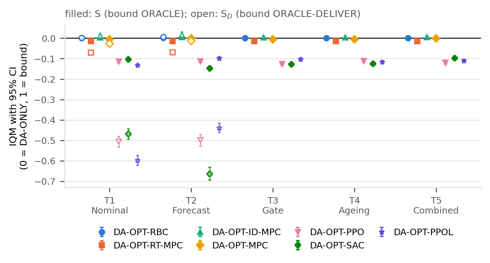

# PV-BESS-Gym

**A Gymnasium benchmark for market-sequenced control of solar-plus-storage in the Greek electricity market.**

PV-BESS-Gym models the three-layer decision sequence of a grid-connected PV+BESS plant in Greece: a D-1 day-ahead and aFRR commitment, gate-closure-delayed intraday corrections, and 15-minute real-time battery dispatch. All three layers live in one Gymnasium environment with a dictionary action interface and transparent settlement accounting.

Version 2.1.0 ships benchmark protocol **rev1** (`configs/journal.yaml`): five tasks on 2025 Greek market data, a perfect-foresight upper bound (ORACLE), a delivery-constrained bound (ORACLE-DELIVER), optimisation and RL baselines, and one command per result.

<p align="center">
  
</p>

> **Upgrading?** Every behaviour change has its own flag. Earlier protocols stay reproducible: `configs/journal_v3.yaml`, `configs/journal_v4.yaml`, and `configs/conf_v1.yaml` (v0.4 conference behaviour). See [CHANGELOG.md](CHANGELOG.md).

---

## Results (protocol rev1, test split, 91 days × 10 activation seeds)

IQM of the normalised score S = (J − J_L)/(U − J_L) with 95% bootstrap CI, where U is the ORACLE bound and J_L the DA-ONLY profit of the same episode (0 = DA-ONLY, 1 = ORACLE). RL: 5 training seeds.

| Controller | T1-Nominal | T2-Forecast | T3-Gate | T4-Ageing | T5-Combined |
|---|---|---|---|---|---|
| DA-OPT-RBC | +0.0005 [−0.0002, +0.0011] | +0.0014 [+0.0004, +0.0025] | +0.0005 [−0.0002, +0.0011] | +0.0004 [−0.0002, +0.0011] | +0.0013 [+0.0002, +0.0024] |
| DA-OPT-RT-MPC | −0.0149 [−0.0166, −0.0133] | −0.0144 [−0.0165, −0.0123] | −0.0149 [−0.0166, −0.0133] | −0.0147 [−0.0164, −0.0130] | −0.0144 [−0.0165, −0.0123] |
| DA-OPT-ID-MPC | +0.0030 [+0.0011, +0.0049] | +0.0048 [+0.0020, +0.0075] | +0.0032 [+0.0012, +0.0051] | +0.0031 [+0.0011, +0.0050] | +0.0051 [+0.0022, +0.0079] |
| DA-OPT-MPC | −0.0050 [−0.0077, −0.0023] | −0.0015 [−0.0047, +0.0019] | −0.0051 [−0.0077, −0.0024] | −0.0049 [−0.0077, −0.0021] | −0.0011 [−0.0045, +0.0022] |
| DA-OPT-PPO | −0.1142 [−0.1200, −0.1082] | −0.1126 [−0.1188, −0.1063] | −0.1260 [−0.1310, −0.1208] | −0.1115 [−0.1170, −0.1060] | −0.1205 [−0.1263, −0.1147] |
| DA-OPT-SAC | −0.1039 [−0.1094, −0.0987] | −0.1470 [−0.1535, −0.1407] | −0.1278 [−0.1346, −0.1213] | −0.1248 [−0.1308, −0.1193] | −0.0972 [−0.1031, −0.0916] |
| DA-OPT-PPOL | −0.1325 [−0.1380, −0.1273] | −0.0985 [−0.1033, −0.0936] | −0.1040 [−0.1099, −0.0980] | −0.1172 [−0.1230, −0.1115] | −0.1110 [−0.1159, −0.1059] |

Mean daily profit [EUR/day], with 95% day-bootstrap CI:

| Controller | T1-Nominal | T2-Forecast | T3-Gate | T4-Ageing | T5-Combined |
|---|---|---|---|---|---|
| DA-ONLY | 373.7 [352.1, 396.2] | 369.4 [347.0, 392.7] | 373.7 [352.1, 396.2] | 364.1 [342.7, 386.3] | 360.0 [337.7, 383.2] |
| DA-OPT-RBC | 374.5 [353.0, 396.8] | 370.7 [348.8, 393.7] | 374.5 [353.0, 396.8] | 364.9 [343.5, 387.1] | 361.3 [339.6, 384.1] |
| DA-OPT-RT-MPC | 365.4 [343.3, 388.4] | 361.8 [339.7, 384.8] | 365.4 [343.3, 388.5] | 355.9 [333.8, 378.8] | 352.4 [330.6, 375.3] |
| DA-OPT-ID-MPC | 370.0 [347.5, 392.6] | 366.5 [343.7, 389.5] | 370.1 [347.5, 392.8] | 360.5 [338.2, 383.1] | 357.4 [334.7, 380.1] |
| DA-OPT-MPC | 370.2 [348.0, 393.9] | 365.9 [342.3, 389.9] | 370.1 [347.8, 393.7] | 360.5 [338.4, 384.0] | 356.5 [333.1, 380.3] |
| DA-OPT-PPO | 270.9 [246.7, 295.8] | 277.4 [254.2, 300.8] | 277.7 [256.0, 299.7] | 252.0 [227.1, 277.5] | 238.9 [199.3, 271.6] |
| DA-OPT-SAC | 229.5 [165.0, 279.1] | −197.5 [−618.7, 122.2] | 237.2 [203.5, 268.6] | 249.2 [219.9, 276.7] | 258.4 [228.0, 289.7] |
| DA-OPT-PPOL | 267.8 [243.5, 292.5] | 284.1 [257.3, 311.2] | 293.9 [261.6, 326.4] | 277.3 [252.2, 301.7] | 264.5 [238.3, 289.5] |
| ORACLE bound U | 1231.7 [1159.2, 1311.3] | 1231.7 [1159.2, 1311.3] | 1230.8 [1158.1, 1310.5] | 1208.5 [1136.4, 1287.6] | 1207.9 [1135.8, 1287.0] |

Reading the numbers:

- The optimisation baselines score close to zero: the intraday and real-time layers add little to a balanced D-1 plan. DA-OPT-ID-MPC has the highest IQM on every task (CI above zero) but a slightly lower mean profit than DA-ONLY.
- Most of the ORACLE bound comes from imbalance positions the plant does not deliver. ORACLE-DELIVER, which must meter its own schedule, has a bound of 557.5 EUR/day on T1 against 1231.7 for ORACLE; the second score S_D uses it (T1/T2).
- The RL baselines score below DA-ONLY on every task.

<p align="center">
  
</p>

Full tables: [results/rev1/tables_rev1.md](results/rev1/tables_rev1.md). Figures: [figures/rev1/](figures/rev1/). Protocol: [docs/BENCHMARK.md](docs/BENCHMARK.md).

---

## Installation

Python 3.10 or newer (the PPO-Lagrangian baseline and the rliable statistics need a separate Python 3.9/3.10 environment). Details and lock files: [docs/INSTALL.md](docs/INSTALL.md).

```bash
python -m venv .venv && source .venv/bin/activate
pip install -e ".[rl,dev]"      # drop [rl] if you do not need the RL baselines
make test
```

## Dataset

Greek market data is **not redistributed** with this repository. Build the benchmark dataset from the publishers' public files, then verify it:

```bash
make data
```

| Provenance | Columns |
|---|---|
| **Real** | weather actuals and archived forecasts (Open-Meteo), DAM and intraday-auction prices (HEnEx), imbalance price and aFRR capacity prices (IPTO) |
| **Synthetic** | `afrr_act_up`, `afrr_act_down` (seeded for reproducibility) |

Sources, assumptions, gap-filling and licence status: [docs/DATA.md](docs/DATA.md).

> **`example_data/` is a legacy sample.** It is the dataset behind the SyNERGY MED 2026 conference results and is kept unchanged for reproducibility, but its DAM, intraday and aFRR capacity prices are proxies derived from the imbalance price. Do not use it for new results.

## Quick start

```python
from pv_bess_gym.benchmark import make_task_env, split_days
from pv_bess_gym.benchmark.episodes import run_episode
from pv_bess_gym import build_registered_algorithm

env = make_task_env("T1-Nominal")                       # protocol rev1 settings
agent = build_registered_algorithm("da-opt-mpc", env)
row = run_episode(env, agent, split_days(env, "test")[0], 0, soc_init=0.5)
print(row["profit_eur"])
```

The tasks are registered as `PVBESS-<task>-v2` (e.g. `gymnasium.make("PVBESS-T1-Nominal-v2")`); the bare environment as `PVBESSGreece-v1`. API reference: [docs/API.md](docs/API.md).

## Running the benchmark

```bash
make benchmark      # ORACLE, ORACLE-DELIVER, baselines, RL training and evaluation, summaries -> results/rev1/
make compute        # timing measurements -> results/rev1/compute.json
make figures        # figures/rev1/*.pdf (sources in figures/src/)
make conformance    # settlement vs the raw HEnEx/IPTO files
```

`make ... PROTOCOL=configs/journal_v3.yaml` runs an earlier protocol. Per-job files are skipped when present, so an interrupted run resumes. Each result file and its command: [results/COMMANDS.md](results/COMMANDS.md).

---

## Market structure and action interface

| Layer | Action key | When | Description |
|---|---|---|---|
| D-1 energy | `day_ahead` | Once, t = 0 | 96-slot DAM schedule [kW] |
| D-1 aFRR capacity | `day_ahead_afrr` | Once, t = 0 | `[cap_up_kw, cap_down_kw]`, fixed for the delivery day |
| Intraday | `intraday` | Every 60 min | `[id_adjustment_kw]`, delivered after the gate closure |
| Real-time | `real_time` | Every 15 min | `[p_batt_kw]`, physical battery setpoint |

`obs["action_mask"]` signals which keys are due at each step:

```python
action = {
    "day_ahead":      np.zeros(96),  # when action_mask[0] == 1
    "day_ahead_afrr": np.zeros(2),   # when action_mask[0] == 1
    "intraday":       np.zeros(1),   # when action_mask[1] == 1
    "real_time":      np.zeros(1),   # every step
}
```

---

## Observation space

`obs` is a dict with four keys:

**`physical`** — shape `(24,)`, current state:

| Index | Signal |
|---|---|
| 0 | Battery SOC |
| 1 | Battery energy kWh |
| 2 | PV actual power kW |
| 3 | PV forecast power kW |
| 4–6 | GHI, temperature, wind |
| 7 | DAM price EUR/MWh |
| 8 | SIDC price EUR/MWh |
| 9 | Imbalance price EUR/MWh (a forecast when `price_noise_sigma > 0`) |
| 10–11 | aFRR up/down capacity prices EUR/MW/h |
| 12–13 | aFRR up/down activation signals [0, 1] |
| 14 | DAM commitment at current step kW |
| 15 | SIDC adjustment at current step kW |
| 16 | Scheduled position (DAM + SIDC) kW |
| 17 | Steps until next intraday block |
| 18 | aFRR block steps remaining |
| 19–20 | Time-of-day sin/cos |
| 21 | Episode progress [0, 1] |
| 22 | D-1 committed aFRR up capacity kW |
| 23 | D-1 committed aFRR down capacity kW |

**`forecast`** — shape `(horizon × 9,)`: rolling forward window of PV, weather, prices, and commercial targets.

**`day_ahead_context`** — shape `(96 × 8,)`: full delivery-day view used by the D-1 optimizer.

**`action_mask`** — shape `(3,)`: which action keys are due this step.

---

## Controllers

| Controller | D-1 | Intraday | Real-time | Kind |
|---|---|---|---|---|
| `da-only` | convex co-optimisation | none | rule-based | lower anchor (J_L) |
| `da-opt-rbc` | convex co-optimisation | rule-based | rule-based | optimisation baseline |
| `da-opt-rt-mpc` | convex co-optimisation | rule-based | MPC | ablation |
| `da-opt-id-mpc` | convex co-optimisation | MPC | rule-based | ablation |
| `da-opt-mpc` | convex co-optimisation | MPC | MPC | optimisation baseline |
| `da-opt-ppo`, `da-opt-sac` | convex co-optimisation | learned | learned | RL baseline (Stable-Baselines3) |
| `da-opt-ppol` | convex co-optimisation | learned | learned | constrained RL baseline (OmniSafe PPO-Lagrangian) |
| ORACLE / ORACLE-DELIVER | perfect-foresight MILP over all layers | | | upper bounds U / U_D |

All controllers share the same D-1 optimisation, a convex quadratic program that co-optimises the DAM schedule and the aFRR capacities, so the benchmark isolates intraday and real-time control.

## Repository layout

```
pv_bess_gym/
  envs/           UnifiedPVBESSGreeceEnv, the Gymnasium environment
  models/         battery, grid, PV (pvlib) and settlement
  agents/         DA-OPT controllers and registry (legacy/ = rolling-horizon agents)
  oracle.py       perfect-foresight MILP bounds (ORACLE, ORACLE-DELIVER)
  benchmark/      tasks, protocol, split, episode runner
  rl/             RL wrappers, OmniSafe adapter, checkpoints
  data/           signal schema, loader, time alignment, dataset builders
  evaluation/     evaluate_agent() and output writer
configs/          journal.yaml (rev1), journal_v3.yaml, journal_v4.yaml, conf_v1.yaml, tasks/
scripts/
  run_journal.py              oracle, baselines, aggregate stages
  summarise_journal.py        scores, CIs, summaries
  rl/                         RL tuning, training, evaluation
  validation/, data/, auxiliary/, diagnostics/
figures/src/      paper figures (make figures)
tests/            unit tests (make test)
docs/             INSTALL, API, BENCHMARK, DATA
results/rev1/     results of protocol rev1
example_data/     v0.4 legacy sample and the example plant configuration
```

## Adding a controller

Implement `reset()` and `act(obs) -> action`, register it in `pv_bess_gym/agents/registry.py`, and evaluate it with `run_episode` on the test split as in the quick start. See `scripts/gym_interface.py` for a template.

---

## Citation

```bibtex
@inproceedings{korkas2026pvbessgym,
  author    = {Korkas, Christos D.},
  title     = {{PV-BESS-Gym}: A Market-Sequenced {Gymnasium} Benchmark
               for Real-Time Control of Solar-plus-Storage
               in the {Greek} Electricity Market},
  booktitle = {Proceedings of the Synergy MED Conference},
  year      = {2026},
}
```

Machine-readable metadata: [CITATION.cff](CITATION.cff).

---

## License

The MIT License (MIT) Copyright (c) 2026, Power & Energy Systems Laboratory, UoWM, Greece
Permission is hereby granted, free of charge, to any person obtaining a copy of this software and associated documentation files (the "Software"), to deal in the Software without restriction, including without limitation the rights to use, copy, modify, merge, publish, distribute, sublicense, and/or sell copies of the Software, and to permit persons to whom the Software is furnished to do so, subject to the following conditions:
The above copyright notice and this permission notice shall be included in all copies or substantial portions of the Software.
THE SOFTWARE IS PROVIDED "AS IS", WITHOUT WARRANTY OF ANY KIND, EXPRESS OR IMPLIED, INCLUDING BUT NOT LIMITED TO THE WARRANTIES OF MERCHANTABILITY, FITNESS FOR A PARTICULAR PURPOSE AND NONINFRINGEMENT. IN NO EVENT SHALL THE AUTHORS OR COPYRIGHT HOLDERS BE LIABLE FOR ANY CLAIM, DAMAGES OR OTHER LIABILITY, WHETHER IN AN ACTION OF CONTRACT, TORT OR OTHERWISE, ARISING FROM, OUT OF OR IN CONNECTION WITH THE SOFTWARE OR THE USE OR OTHER DEALINGS IN THE SOFTWARE.
